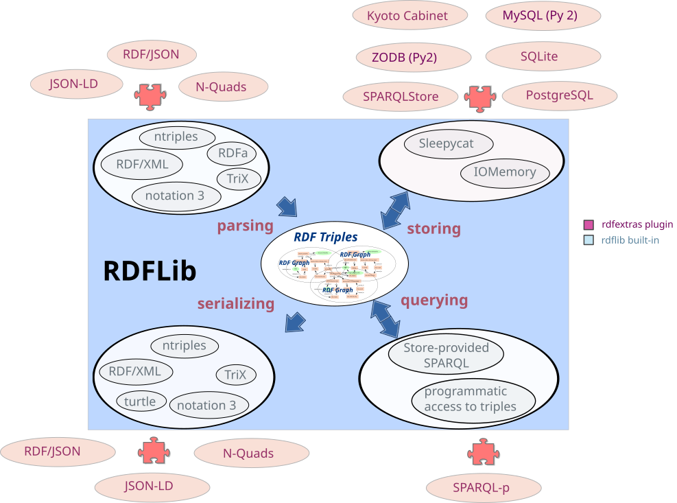

# Plugins



Many parts of RDFLib are extensible with plugins, [see setuptools' 'Creating and discovering plugins'](https://packaging.python.org/guides/creating-and-discovering-plugins/). These pages list the plugins included in RDFLib core.

* [`Parser Plugins`][rdflib.plugins.parsers]
* [`Serializer Plugins`][rdflib.plugins.serializers]
* [`Store Plugins`][rdflib.plugins.stores]
* [`Query Results Plugins`][rdflib.plugins.sparql.results]

## Plugin stores

### Built In

The following Stores are contained within the rdflib core package:

| Name | Class |
| --- | --- |
| Auditable | [`AuditableStore`][rdflib.plugins.stores.auditable.AuditableStore] |
| Concurrent | [`ConcurrentStore`][rdflib.plugins.stores.concurrent.ConcurrentStore] |
| SimpleMemory | [`SimpleMemory`][rdflib.plugins.stores.memory.SimpleMemory] |
| Memory | [`Memory`][rdflib.plugins.stores.memory.Memory] |
| SPARQLStore | [`SPARQLStore`][rdflib.plugins.stores.sparqlstore.SPARQLStore] |
| SPARQLUpdateStore | [`SPARQLUpdateStore`][rdflib.plugins.stores.sparqlstore.SPARQLUpdateStore] |
| BerkeleyDB | [`BerkeleyDB`][rdflib.plugins.stores.berkeleydb.BerkeleyDB] |
| default | [`Memory`][rdflib.plugins.stores.memory.Memory] |

### External

The following Stores are defined externally to rdflib's core package, so look to their documentation elsewhere for specific details of use.

| Name | Repository | Notes |
| --- | --- | --- |
| Tentris | [repo](https://github.com/tentris/tentris) &#124; [PyPI](https://pypi.org/project/tentris/) &#124; [docs](https://docs.tentris.io/running_with_python.html) | Use the fast, in-memory [Tentris](https://tentris.io/) [WCOJ](https://en.wikipedia.org/wiki/Worst-case_optimal_join_algorithm) SPARQL engine as [native backend for rdflib's Graph](https://docs.tentris.io/running_with_python.html#native) or use rdflib's Graph to [connect to a running persistent Tentris instances via HTTP](https://docs.tentris.io/running_with_python.html#http). |
| SQLAlchemy | [github.com/RDFLib/rdflib-sqlalchemy](https://github.com/RDFLib/rdflib-sqlalchemy) | An SQLAlchemy-backed, formula-aware RDFLib Store. Tested dialects are: SQLite, MySQL & PostgreSQL |
| leveldb | [github.com/RDFLib/rdflib-leveldb](https://github.com/RDFLib/rdflib-leveldb) | An adaptation of RDFLib BerkeleyDB Store's key-value approach, using LevelDB as a back-end |
| Kyoto Cabinet | [github.com/RDFLib/rdflib-kyotocabinet](https://github.com/RDFLib/rdflib-kyotocabinet) | An adaptation of RDFLib BerkeleyDB Store's key-value approach, using Kyoto Cabinet as a back-end |
| HDT | [github.com/RDFLib/rdflib-hdt](https://github.com/RDFLib/rdflib-hdt) | A Store back-end for rdflib to allow for reading and querying [HDT](https://www.rdfhdt.org/) documents |
| Oxigraph | [github.com/oxigraph/oxrdflib](https://github.com/oxigraph/oxrdflib) | Works with the [Pyoxigraph](https://oxigraph.org/pyoxigraph) Python graph database library |
| pycottas | [github.com/arenas-guerrero-julian/pycottas](https://github.com/arenas-guerrero-julian/pycottas) | A Store backend for querying compressed [COTTAS](https://pycottas.readthedocs.io/#cottas-files) files |

*If you have, or know of a Store implementation and would like it listed here, please submit a Pull Request!*

### Use

You can use these stores like this:

```python
from rdflib import Graph

# use the default memory Store
graph = Graph()

# use the BerkeleyDB Store
graph = Graph(store="BerkeleyDB")
```

In some cases, you must explicitly *open* and *close* a store, for example:

```python
from rdflib import Graph

# use the BerkeleyDB Store
graph = Graph(store="BerkeleyDB")
graph.open("/some/folder/location")
# do things ...
graph.close()
```

## Plugin parsers

These serializers are available in default RDFLib, you can use them by passing the name to graph's [`parse()`][rdflib.graph.Graph.parse] method:

```python
graph.parse(my_url, format='n3')
```

The `html` parser will auto-detect RDFa, HTurtle or Microdata.

It is also possible to pass a mime-type for the `format` parameter:

```python
graph.parse(my_url, format='application/rdf+xml')
```

If you are not sure what format your file will be, you can use [`guess_format()`][rdflib.util.guess_format] which will guess based on the file extension.

| Name    | Class                                                         |
|---------|---------------------------------------------------------------|
| json-ld | [`JsonLDParser`][rdflib.plugins.parsers.jsonld.JsonLDParser]  |
| hext    | [`HextuplesParser`][rdflib.plugins.parsers.hext.HextuplesParser] |
| jelly   | `RDFLibJellyParser`, from [pyjelly](https://w3id.org/jelly/pyjelly) |
| n3      | [`N3Parser`][rdflib.plugins.parsers.notation3.N3Parser]       |
| nquads  | [`NQuadsParser`][rdflib.plugins.parsers.nquads.NQuadsParser]  |
| patch   | [`RDFPatchParser`][rdflib.plugins.parsers.patch.RDFPatchParser] |
| nt      | [`NTParser`][rdflib.plugins.parsers.ntriples.NTParser]        |
| trix    | [`TriXParser`][rdflib.plugins.parsers.trix.TriXParser]        |
| turtle  | [`TurtleParser`][rdflib.plugins.parsers.notation3.TurtleParser] |
| xml     | [`RDFXMLParser`][rdflib.plugins.parsers.rdfxml.RDFXMLParser]  |

### Multi-graph IDs

Note that for correct parsing of multi-graph data, e.g. TriG, HexTuple, etc., into a `Dataset`, as opposed to a context-unaware `Graph`, you will need to set the `publicID` of the `Dataset` to the identifier of the `default_context` (default graph), for example:

```python
d = Dataset()
d.parse(
    data=""" ... """,
    format="trig",
    publicID=d.default_context.identifier
)
```

(from the file tests/test_serializer_hext.py)

## Plugin serializers

These serializers are available in default RDFLib, you can use them by
passing the name to a graph's [`serialize()`][rdflib.graph.Graph.serialize] method:

```python
print graph.serialize(format='n3')
```

It is also possible to pass a mime-type for the `format` parameter:

```python
graph.serialize(my_url, format='application/rdf+xml')
```

| Name       | Class                                                                                |
|------------|--------------------------------------------------------------------------------------|
| json-ld    | [`JsonLDSerializer`][rdflib.plugins.serializers.jsonld.JsonLDSerializer]             |
| n3         | [`N3Serializer`][rdflib.plugins.serializers.n3.N3Serializer]                         |
| nquads     | [`NQuadsSerializer`][rdflib.plugins.serializers.nquads.NQuadsSerializer]             |
| nt         | [`NTSerializer`][rdflib.plugins.serializers.nt.NTSerializer]                         |
| hext       | [`HextuplesSerializer`][rdflib.plugins.serializers.hext.HextuplesSerializer]         |
| jelly      | `RDFLibJellySerializer`, from [pyjelly](https://w3id.org/jelly/pyjelly)              |
| patch      | [`PatchSerializer`][rdflib.plugins.serializers.patch.PatchSerializer]                |
| pretty-xml | [`PrettyXMLSerializer`][rdflib.plugins.serializers.rdfxml.PrettyXMLSerializer]       |
| trig       | [`TrigSerializer`][rdflib.plugins.serializers.trig.TrigSerializer]                   |
| trix       | [`TriXSerializer`][rdflib.plugins.serializers.trix.TriXSerializer]                   |
| turtle     | [`TurtleSerializer`][rdflib.plugins.serializers.turtle.TurtleSerializer]             |
| longturtle | [`TurtleSerializer`][rdflib.plugins.serializers.turtle.TurtleSerializer]             |
| origturtle | [`OrigTurtleSerializer`][rdflib.plugins.serializers.origturtle.OrigTurtleSerializer] |
| xml        | [`XMLSerializer`][rdflib.plugins.serializers.rdfxml.XMLSerializer]                   |

### JSON-LD

JSON-LD - 'json-ld' - has been incorporated into RDFLib since v6.0.0.

### RDF Patch

The RDF Patch Serializer - 'patch' - uses the RDF Patch format defined at https://afs.github.io/rdf-patch/. It supports serializing context aware stores as either addition or deletion patches; and also supports serializing the difference between two context aware stores as a Patch of additions and deletions.

### HexTuples

The HexTuples Serializer - 'hext' - uses the HexTuples format defined at https://github.com/ontola/hextuples.

For serialization of non-context-aware data sources, e.g. a single `Graph`, the 'graph' field (6th variable in the Hextuple) will be an empty string.

For context-aware (multi-graph) serialization, the 'graph' field of the default graph will be an empty string and the values for other graphs will be Blank Node IDs or IRIs.

### Jelly

[Jelly](https://w3id.org/jelly) is a binary format for streams of RDF triples
or quads, based on Protocol Buffers. It is fast to read and write and compact.
RDFLib reads and writes it with [pyjelly](https://w3id.org/jelly/pyjelly),
which is installed with RDFLib. The format name is `jelly`, the media type is
`application/x-jelly-rdf`, and files end in `.jelly`.

```python
from rdflib import Dataset

d = Dataset()
d.parse("data.trig")
d.serialize(destination="data.jelly", format="jelly")
d2 = Dataset().parse("data.jelly")
```

As Jelly is binary, `serialize()` can't return it as a `str`. Give it a
`destination`, or an `encoding` to get `bytes`, which Jelly ignores:
`g.serialize(format="jelly", encoding="utf-8")`.

A `Dataset` is written as quads and a `Graph` as triples. Read into a `Graph`,
a stream of quads gives the triples of its default graph only, as with N-Quads.
Read into a `Dataset`, a stream of triples goes into the default graph.

Some things to know:

* In RDF, `"x"^^xsd:string` and `"x"` are the same term, and Jelly writes both as
  `"x"`. RDFLib reads that as `Literal("x")`, which
  [`Literal`][rdflib.term.Literal]'s `==` tells apart from
  `Literal("x", datatype=XSD.string)` (its `eq()` method doesn't). To compare
  graphs after a round trip, write string literals without a datatype.
* Namespace prefixes are not written by default. pyjelly's options turn them on,
  and other options, like the size of the lookup tables, are set the same way:

    ```python
    from pyjelly.options import StreamParameters
    from pyjelly.serialize.streams import SerializerOptions

    options = SerializerOptions(params=StreamParameters(namespace_declarations=True))
    g.serialize(destination="data.jelly", format="jelly", options=options)
    ```

SPARQL query results can be written in Jelly too, see
[Jelly-SPARQL](#jelly-sparql).

See the [pyjelly documentation](https://w3id.org/jelly/pyjelly) for more, such
as writing and reading streams of many graphs.

### Longturtle

The `longturtle` format name remains available as an alias of the default `turtle`
serializer. Use `origturtle` for the previous compact formatting.

Longturtle is just the turtle format with newlines preferred over compactness - multiple nodes on the same line to enhance the format's text file version control (think Git) friendliness - and more modern forms of prefix markers - PREFIX instead of @prefix - to make it as similar to SPARQL as possible.

Longturtle is Turtle 1.1 compliant and will work wherever ordinary turtle works, however some very old parsers don't understand PREFIX, only @prefix...

## Plugin query results

Plugins for reading and writing of (SPARQL) [`Result`][rdflib.query.Result] - pass `name` to either [`parse()`][rdflib.query.Result.parse] or [`serialize()`][rdflib.query.Result.serialize]

### Parsers

| Name | Class |
| ---- | ----- |
| csv  | [`CSVResultParser`][rdflib.plugins.sparql.results.csvresults.CSVResultParser] |
| jelly | `RDFLibJellySparqlParser`, from [pyjelly](https://w3id.org/jelly/pyjelly) |
| json | [`JSONResultParser`][rdflib.plugins.sparql.results.jsonresults.JSONResultParser] |
| tsv  | [`TSVResultParser`][rdflib.plugins.sparql.results.tsvresults.TSVResultParser] |
| xml  | [`XMLResultParser`][rdflib.plugins.sparql.results.xmlresults.XMLResultParser] |

### Serializers

| Name | Class |
| ---- | ----- |
| csv  | [`CSVResultSerializer`][rdflib.plugins.sparql.results.csvresults.CSVResultSerializer] |
| jelly | `RDFLibJellySparqlSerializer`, from [pyjelly](https://w3id.org/jelly/pyjelly) |
| json | [`JSONResultSerializer`][rdflib.plugins.sparql.results.jsonresults.JSONResultSerializer] |
| txt  | [`TXTResultSerializer`][rdflib.plugins.sparql.results.txtresults.TXTResultSerializer] |
| xml  | [`XMLResultSerializer`][rdflib.plugins.sparql.results.xmlresults.XMLResultSerializer] |

### Jelly-SPARQL

[Jelly-SPARQL](https://w3id.org/jelly) is the binary Jelly format for the
results of SELECT and ASK queries. Its format name is `jelly` (or `jellys`),
its media type is `application/x-jelly-sparql`, and files end in `.jellys`.

```python
from io import BytesIO
from rdflib.query import Result

result = graph.query("SELECT ?s ?o WHERE { ?s ?p ?o }")
data = result.serialize(format="jelly")  # bytes
result = Result.parse(BytesIO(data), format="jelly")
```

The results of CONSTRUCT and DESCRIBE queries are graphs, so
`result.serialize(format="jelly")` writes them in [Jelly](#jelly). To read
them back as a result, give the media type of Jelly, as `format="jelly"` means
Jelly-SPARQL here:
`Result.parse(source, content_type="application/x-jelly-rdf")`.

As with Jelly, results are read from and written to binary streams only, and
`"x"^^xsd:string` is read as `Literal("x")`, the same RDF term.

A [`SPARQLStore`][rdflib.plugins.stores.sparqlstore.SPARQLStore] made with
`returnFormat="jelly"` asks the endpoint for Jelly-SPARQL and Jelly, and reads
either.
